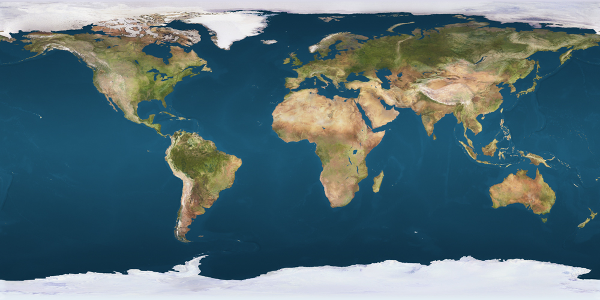

# 🌌 3D Solar System Explorer

**Interactive 3D Solar System simulation built with Three.js** — explore planets, their realistic orbits, detailed textures, and the beauty of space directly in your browser.

[](https://harrysurya08792-ai.github.io/Solar-Systempush/)
[](https://threejs.org/)
[](LICENSE)


## 📖 Description

The **3D Solar System Explorer** is a web-based, interactive space simulation that renders our solar system in 3D using [Three.js](https://threejs.org/). It features realistic orbital mechanics, high-quality planet textures, smooth camera controls, and educational information about each celestial body — all running in the browser with no installation required.

### ✨ Features

- 🌞 **Realistic Physics** — accurate orbital mechanics with proper scaling and timing
- 🎮 **Interactive Controls** — zoom, pan, and rotate with smooth OrbitControls
- 📚 **Educational** — planet details, distance, size, gravity, and fun facts
- 🎨 **Beautiful Graphics** — high-quality textures, realistic lighting, and a starfield background
- ⚙️ **Dat.GUI Panel** — adjust simulation speed and settings in real time
- 📱 **Responsive** — works on desktop and mobile browsers

## 🚀 Live Demo

Experience the project directly in your browser:

👉 **[https://harrysurya08792-ai.github.io/Solar-Systempush/](https://harrysurya08792-ai.github.io/Solar-Systempush/)**

See the **"Hosting a Live Demo (GitHub Pages)"** section below to deploy your own copy.

## 🛠️ Installation

No build step or installation is required — this is a vanilla HTML/CSS/JS project that loads Three.js via CDN.

### Option 1: Open locally

```bash
# Clone the repository
git clone https://github.com/harrysurya08792-ai/Solar-Systempush.git

# Enter the project folder
cd Solar-Systempush

# Open in your browser
open index.html   # macOS
# or double-click index.html
```

### Option 2: Serve locally (recommended)

Some browsers block ES module imports when opening `index.html` via `file://`. Use a local server instead:

```bash
# Python 3
python3 -m http.server 8000

# Python 2
python -m SimpleHTTPServer 8000

# Node.js (if you have http-server installed)
npx http-server

# Then visit: http://localhost:8000
```

## 🎮 Usage

1. Open `index.html` in a modern browser (Chrome, Firefox, Safari, or Edge).
2. Click **Start Exploration** to enter the 3D solar system.
3. Use your mouse to interact:
   - **Left Click + Drag** — Rotate the camera
   - **Right Click + Drag** — Pan
   - **Scroll** — Zoom in/out
   - **Dat.GUI Panel** — adjust simulation speed and settings
4. Click on a planet to view its details in the info panel.

## 📁 Project Structure

```
Solar-Systempush/
├── index.html            # Main entry point and UI
├── solarSystem.js        # Three.js 3D simulation logic
├── Planet.js             # Planet class and orbital behavior
├── LICENSE               # Educational-use license
├── TODO.md               # Planned improvements
├── README.md             # This file
├── image/                # Project media (textures, screenshots)
│   ├── solar-system.png  # Preview image / favicon
│   ├── sun.jpg           # Sun texture
│   ├── mercury.jpg       # Mercury texture
│   ├── venus.jpg         # Venus texture
│   ├── earth.jpg         # Earth texture
│   ├── mars.jpg          # Mars texture
│   ├── jupiter.jpg       # Jupiter texture
│   ├── saturn.jpg        # Saturn texture
│   ├── saturn_ring.png   # Saturn ring texture
│   ├── uranus.jpg        # Uranus texture
│   ├── uranus_ring.png   # Uranus ring texture
│   ├── neptune.jpg       # Neptune texture
│   ├── pluto.jpg         # Pluto texture
│   └── stars.jpg         # Starfield background
└── .gitignore            # Files ignored by Git
```

## 🖼️ Media & Assets

All planet textures, rings, the starfield, and the preview image live in the `image/` directory.

- **Preview image:** `image/solar-system.png` — used as the Open Graph image and favicon.
- **Planet textures:** `image/<planet>.jpg` for each planet and the sun.
- **Rings:** `image/saturn_ring.png`, `image/uranus_ring.png`.

To add new media:
1. Place the file under `image/`.
2. Reference it relatively in code or Markdown, e.g. `./image/your-file.png`.
3. Keep image file sizes reasonable (compress JPEGs/PNGs) so the demo loads quickly.

See the **"Displaying Project Media"** section below for README embedding examples.

## 🌐 Hosting a Live Demo (GitHub Pages)

GitHub Pages lets you host this static project for free so anyone can interact with it from the browser.

### Enable GitHub Pages

1. Push this repository to GitHub (see the Git commands below).
2. On GitHub, go to your repository → **Settings** → **Pages** (in the left sidebar).
3. Under **Build and deployment** → **Source**, select **Deploy from a branch**.
4. Choose the `main` branch and the `/ (root)` folder, then click **Save**.
5. Wait a minute or two. Your site will be published at:
   `https://<your-username>.github.io/<repository-name>/`

### Verify the deployment

- Visit the Pages URL shown in the Settings → Pages section.
- The demo loads `index.html` automatically, so no extra configuration is needed.

### Alternative hosts

You can also host the live demo on:
- **Vercel** — `vercel` CLI, zero-config static hosting
- **Netlify** — drag-and-drop or Git-connected deploys
- **GitHub Pages** (recommended, free, and integrated with your repo)

## 📸 Displaying Project Media

### In the README

Embed screenshots and GIFs using relative paths so they render on GitHub and in GitHub Pages:

```markdown



```

### In HTML

Reference media from `index.html` or JavaScript using relative paths:

```html
<link rel="icon" type="image/png" href="./image/solar-system.png" />
<meta property="og:image" content="./image/solar-system.png" />
```

```js
const textureLoader = new THREE.TextureLoader();
const earthTexture = textureLoader.load('./image/earth.jpg');
```

### Best practices

- Store all media under `image/` so the repository stays organized.
- Use descriptive filenames (`mercury.jpg`, `saturn_ring.png`).
- Compress images before committing to keep the repo size small.
- Add a short video/GIF demo under `image/` (e.g. `image/demo.mp4`) and embed it:

  ```markdown
  
  ```

## 🤝 Contributing

Contributions are welcome! Please:

1. Fork the repository.
2. Create a feature branch (`git checkout -b feature/your-feature`).
3. Commit your changes (`git commit -m "Add your feature"`).
4. Push to the branch (`git push origin feature/your-feature`).
5. Open a Pull Request.

See `TODO.md` for planned improvements.

## 📜 License

This project is licensed under an **educational-use only** license. See [LICENSE](LICENSE) for details. Commercial use requires prior written permission from the copyright holder.

## 👏 Acknowledgments

- [Three.js](https://threejs.org/) — 3D library
- [dat.GUI](https://github.com/dataarts/dat.gui) — configuration panel
- [Unpkg CDN](https://unpkg.com/) — module delivery

---

Made with ❤️ and 🚀 by [harrysurya08792-ai](https://github.com/harrysurya08792-ai)
